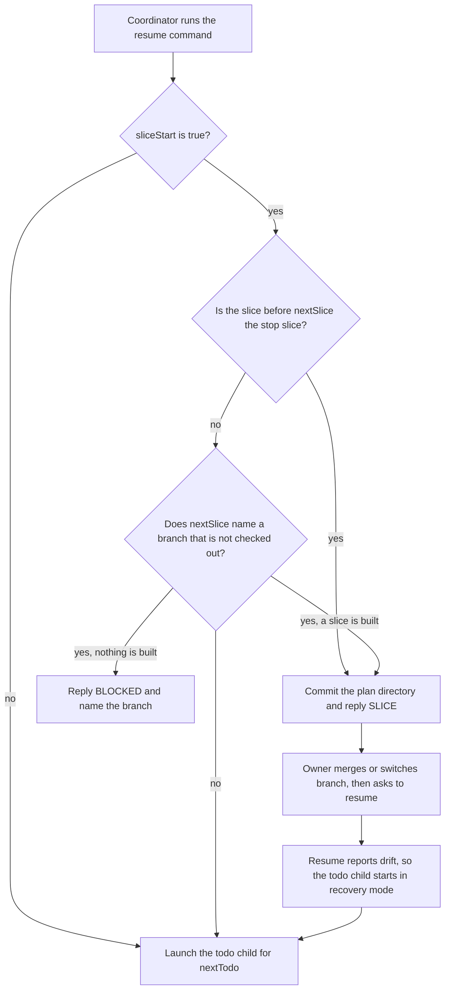

<!-- markdownlint-disable-next-line MD025 -->
# Plan skills 2.1.0 — Behavior first and slices for large plans

Files: [Evidence index](2026-11-20-behavior-first-and-slices.evidence-index.md) · [Reviews](2026-11-20-behavior-first-and-slices.reviews.md) · [Gate record](2026-11-20-behavior-first-and-slices.gate-record.json) · [Build](2026-11-20-behavior-first-and-slices.build.md)

## TL;DR

- Effort: L — seven implementation todos across the validator, five skills, one helper script, and their tests.
- Risk: medium — a rule that is not optional would break 2.0.0 plans and builds in progress, and a slice stop moves HEAD before every resume.
- Decisions made: Behavior lines live in an optional `## Behavior` section and todos gain `Serves`, because an optional part keeps 2.0.0 plans valid; a slice is one line above its waves, because wave order stays as it is; a slice stop is a plan-only commit plus the existing recovery, because the receipt chain needs no new event.
- Owner decisions pending: none
- Cut from scope: a rule on the number of Behavior lines, a new check letter, a new receipt event, a final wave per slice, and edits to personas and examples.
- Who notices: owners approve Behavior lines at the draft gate and can ask for one slice at a time; reviewers and builders see two new target kinds and one new verdict; a 2.0.0 plan behaves as before.
- Branch: `feat/plan-skills-behavior-slices` — the `<type>/<kebab-name>` pattern this repository uses, cut from `main` once it holds the README comparison commit `a72b7f5`. The 2.0.0 pull request is merged.

## Scope

### IS / GAP ledger

| Gap | IS today (evidence) | GAP |
| --- | --- | --- |
| G1 | `skills/planning/plan-review/scripts/validate-plan.ts:53-63` — a spec has nine fixed sections, and `:1117-1122` rejects any other. A todo has nine fields (`:142-152`), and the parser keeps only those (`:574-575`). Review targets cover requirements, todos, dependencies, flows, contracts and checks (`:1549-1561`). | The validator rejects a `## Behavior` section, ignores a `Serves` field, and checks nothing about Behavior lines. The reviewer and the builder get nothing about them. |
| G2 | `skills/planning/plan-review/scripts/validate-plan.ts:605-615` — the execution strategy parser reads only wave lines. A pass receipt must record only the acceptance and QA checks (`:1922-1924`). Resume mode reports only the next todo (`:2231-2233`). | There is no slice grammar, no check that a slice's independent test ran, and no output that says where a slice starts. |
| G3 | `skills/planning/plan-writer/SKILL.md:47` — deep analysis starts with the ledger. `:48` asks product and technical questions. `:197-208` — the todo template has nine fields. | The writer states no user-visible behavior, asks the owner to approve none, and ties no todo to one. |
| G4 | `skills/planning/plan-writer/SKILL.md:54` — todos are grouped only into waves. `:172-178` — the execution strategy template has only wave lines. `:277-283` — the planned reply offers a review or a whole build. | A large plan cannot be split into parts that ship alone, and the reply suggests no first part. |
| G5 | `skills/planning/plan-review/SKILL.md:51` and `:164` list the gate-record targets. `skills/planning/plan-review/references/writer-contract.md:42-51` holds the Check J rules. `skills/planning/plan-review/references/evidence-gate.md:74-84` lists what is not a blocker. | The reviewer has no rule and no gate-record target for a Behavior line, a `Serves` mapping, or a slice. |
| G6 | `skills/planning/plan-builder/SKILL.md:41-47` — each step acts on the next todo. `:73-79` — five verdict lines, none for a part of a plan. `skills/planning/plan-builder/references/receipts.md:86-91` — a stop makes no commit of its own. | The builder cannot build one slice, stop with the plan directory committed, and resume with the next slice later. |
| G7 | `skills/planning/plan-result-review/scripts/inventory-changes.ts:348-358` — the brief lists requirements, todos, fixes, changes and unnamed commits. `skills/planning/plan-result-review/SKILL.md:41-42` maps requirements and compares one branch. `skills/planning/plan-result-review/references/differences.md:33-51` weighs differences. | The result review cannot check a Behavior line against the build. It would read a slice commit, or a branch per slice, as a difference. |
| G8 | `skills/planning/plan-loop/SKILL.md:36` — the loop launches a writer child, waits for `status: planned`, then starts the review rounds. | A writer child cannot ask the owner, so in the loop the Behavior lines are approved only by default. The owner never sees them before the review. |
| G9 | `README.md:133-147` — the Planning flow section describes the writer, the reviewer, the loop and the build. | A README reader does not learn that a plan states Behavior lines and that a large plan can be built slice by slice. |
| G10 | `README.md:164-184` — the comparison with Spec Kit is written beside the plan skills at 2.0.0 (`:166`). Its `Starts from` row names only the gaps in the code (`:170`), its `Slicing` row says that the plan builds as one piece (`:177`), and its last sentence says that both ideas are planned (`:184`). | Once 2.1.0 ships, the comparison is wrong in these four places. |

### Risks

| Risk | What breaks | Mitigation | Carried by |
| --- | --- | --- | --- |
| A new rule fires on a plan with no Behavior section and no slices | A 2.0.0 plan stops validating, or a build in progress stops resuming | Every new rule and every new JSON key applies only when the plan has the new part. A test compares a 2.0.0 fixture's full output before and after. | T1, T2 |
| The file path check flags a normal word | A good Behavior line becomes an error | The must-pass and must-fail lists in Design are test cases. | T1 |
| `B<n>` names both a Behavior line and a review blocker | A reader mixes the two up in a review | Review prose always writes "Behavior B2". Gate-record targets use `behavior:B<n>`. | T4, T6 |
| A slice stop moves HEAD | Every resume after a slice stop reports drift | This is the existing recovery path: one recovery receipt, nothing replayed. The slice rules say so. | T5 |
| Snapshots live in the local Git directory | A resume from another clone cannot verify the state | The `SLICE` reply says the build resumes in the same clone. The existing missing-snapshot error stops a resume anywhere else. | T5 |
| A merge between slices brings in commits that no todo made | The result review reads them as unnamed commits | The result review rules name a merge of an earlier slice as not a difference. | T6 |
| Every interactive plan stops once at the draft gate | One more owner turn for a plan that had no other question | The stop carries every open question in one message, as today. | T3 |
| The skill prompts grow | Token use goes up again | Each rule has one home. The writer reads its Behavior reference only at that step. | T3, T4, T5 |
| The build starts from a base without commit `a72b7f5` | The README has no comparison section for T7 to update | Cut the branch only after that commit is on `main`. On any other base the validator reports a changed hash for the README and the changelog, and the README check in Design fails. | T7 |

### Must have

- MH1: A plan with no Behavior section and no slices gets the same validator errors, gaps, review targets and JSON keys in every mode as it does today, and it reviews and builds without change.
- MH2: The validator accepts an optional `## Behavior` section and reports a `BEHAVIOR` error for a malformed line, a file path in a line, a missing case, a todo without `Serves`, and a Behavior line that no todo serves.
- MH3: A vague word in a Behavior line is reported as a gap, never as an error.
- MH4: The validator accepts slice lines in the execution strategy, reports `SLICE` errors, requires a passing `slice:S<n>` check on the pass receipt of each slice's last todo, and prints `slices`, `nextSlice` and `sliceStart`.
- MH5: The writer writes three to seven Behavior lines before the ledger, covers the four cases, records the owner's approval as the first product question, stops an interactive run until approved, and gives every implementation todo a `Serves` field.
- MH6: For a large plan the writer groups the waves into slices, with shared setup in a first slice named `foundation` and one independent test per slice. The planned reply names a suggested first slice.
- MH7: The plan review covers each `behavior:B<n>` and `slice:S<n>` target in the gate record and judges them by rules in Check J.
- MH8: The builder can stop at a slice boundary, commit the plan directory, reply with the `SLICE` verdict, and resume with the next slice through the existing recovery rules.
- MH9: The result review checks every Behavior line against the build. An unmet line is blocking. A slice commit, or a merge that only brings in an earlier slice, is not a difference.
- MH10: Before round 1, `plan-loop` shows the owner any Behavior lines approved only by default, and waits.
- MH11: Each changed skill carries its new version and a `CHANGELOG.md` line in the commit of its first change, and the README names both ideas.
- MH12: The writer has one small reference with two or three good and bad Behavior line pairs. Its workflow links that file only at the Behavior step.
- MH13: The README's comparison with Spec Kit is true for 2.1.0: the intro names that version, the `Starts from` row names Behavior lines that the owner approves, the `Slicing` row describes slices, and the last sentence says both ideas are in 2.1.0.

### Must NOT have

- MN1: No rule or JSON key that changes the result for a plan without the new parts. A 2.0.0 plan must keep working.
- MN2: No new frontmatter key, evidence index key, `schemaVersion`, check letter, receipt event, or child role. Each would break a 2.0.0 record or add weight.
- MN3: No validator rule on the number of Behavior lines. "About three to seven" is guidance for the writer.
- MN4: No change to drift detection, the receipt chain rules, or the snapshot format. A slice stop uses them as they are.
- MN5: The builder never creates, switches, or pushes a branch. The owner does that between slices.
- MN6: No final wave and no result review per slice. Both run once, after the last slice.
- MN7: No workflow step is renumbered in any skill. Other files refer to the numbers.
- MN8: No separate spec, plan and task files, constitution file, living spec, one-question-at-a-time clarification, or project-rules check in the plan review. The owner ruled these out.
- MN9: No edit to a persona under `agents/`, an `examples.md`, a benchmark page, or the 2.0.0 design. No rule there changes.
- MN10: No rule stated twice. Each new rule has one home, and other files link to it.
- MN11: No edit to the Spec Kit column, the other rows, or the "Pick Spec Kit when" paragraph of the README's comparison. The owner asked to leave them as they are.

### Critical flows

- FL1: slice stop and resume; counterexample: a resume from a fresh clone, where the snapshots are missing, must stop with an error instead of building. The trace is evidence index flow FL1.

### Baseline

- Revision: `a72b7f5d45c2299e1fb588db3fa673d427709c59` on `feat/lighter-plan-skills`. Its files are those of `main` at merge commit `ee199cd`, which holds the merged 2.0.0 pull request, plus one commit that adds the README comparison section and its changelog line. That commit is merged into `main` before the build starts, so the build begins from a base that contains it. No dirty file apart from this plan's own untracked directory.
- `bun run validate`: exit 0 — 18 skills validated, 0 errors, 8 agent personas.
- `bun test`: exit 0 — 322 pass, 0 fail, across 9 files (Bun 1.4.3). Of these, `scripts/validate-plan.test.ts` has 94 tests and `scripts/planning-build-state.test.ts` has 5.
- Not run here: the markdown lint and the link check. They run only in CI.

## Research

- Sources: No useful public source found for a contract, and no todo relies on an external one. The two ideas come from the command prompts of [GitHub Spec Kit](https://github.com/github/spec-kit), read as background only. This plan adopts nothing else from it.
- What this plan will follow: the 2.0.0 design in `docs/plans/2026-11-20-lighter-plan-skills.md`, the skill contract at `skills/workflow/skill-writer/SKILL.md:120-190`, and the version rules at `CONTRIBUTING.md:9-11`.

## Questions

### Product

- The two ideas and their details: Behavior lines, the `Serves` mapping, the example reference, the scenario scan, the script checks, slices, the foundational slice, the independent test, and the suggested first slice — answer: approved by the owner in the request.
- Should `plan-loop` pause before round 1 to show the owner Behavior lines that were approved only by default? — answer: yes. A writer child cannot ask the owner, and the owner asked to approve the lines.
- Should a Behavior line that the build does not show block the result review? — answer: yes, it blocks. The lines are the outcome the owner approved.
- When a build request names no slice, should the builder build every slice? — answer: yes, stopping only where the next slice names a branch that is not checked out. The builder never switches branches.

### Technical

- Where do the Behavior lines live? — default: an optional `## Behavior` section directly after `## TL;DR`, because it is near the top and an optional section keeps a 2.0.0 plan valid.
- What does a todo write when it serves no Behavior line? — default: `Serves: none`, because an explicit value separates a setup todo from a forgotten field.
- How does a resume see a slice stop? — default: the slice commit and any merge are plain drift, recorded by one recovery receipt, because the receipt chain compares snapshots and needs no new event.
- How does the validator know that a slice's independent test ran? — default: a passing `slice:S<n>` check on the pass receipt of the slice's last todo, because the existing `MISSING_CHECK` error then enforces it.

## Design

Both ideas are optional parts of plan format 2. A plan without them takes none of the new paths below. The diagram shows the one new runtime path, the slice stop.



### Behavior lines

A plan may have a `## Behavior` section directly after `## TL;DR`. It holds Behavior lines and exclusion lines:

```markdown
## Behavior

- B1 (primary): Given a pull request that adds a duplicated block, when the lint command runs, then it fails and names the block.
- B2 (error): Given a block the lint command cannot parse, when it runs, then it reports that block and still checks the others.
- No alternate case: the lint command has one way to run.
- No recovery case: a failed run changes nothing.
```

The validator rules all use the error code `BEHAVIOR`. None applies to a plan without the section.

- At every status: each line in the section, outside a fence or a comment, is a Behavior line or an exclusion line. Ids count up from B1. The case is `primary`, `alternate`, `error` or `recovery`. `Given`, `when` and `then` appear in that order. No word is a file path.
- From `planned` on: a `primary` line exists, and each other case has a line or an exclusion. Every todo except T0 has a `Serves` field after `Closes gap`, holding `none` or known Behavior ids. Every Behavior line is served by at least one todo.
- A Behavior line has the word caps of a Must have bullet.
- There is no rule on the number of lines.

The path check strips wrapping backticks, quotes, brackets, trailing punctuation and a trailing line number from each word, and skips a URL. A word is then a file path when:

- it starts with `./`, `../` or `~/`; or
- it contains `/` and ends with a dot, one letter, and up to four more letters or digits; or
- it has no `/` and ends with a dot and one of `md`, `json`, `ts`, `tsx`, `py`, `sh`, `yml`, `yaml`, `toml`, `lock`, `sql`, `css`, `html`, `txt`.

These words are the test cases:

```text
must pass: and/or  read/write  v2.1.0  e.g.  Node.js  https://example.com/a.html  /pricing  1.0/2.0
must fail: src/app.ts  ./run.sh  ../shared  ~/notes  README.md  package.json  src/app.ts:12
```

A vague word is reported as a gap, `vague word '<word>' in B<n>`, never as an error. The words are: fast, quick, quickly, robust, secure, scalable, reliable, efficient, intuitive, seamless, user-friendly, properly, correctly.

Output for a plan with Behavior lines: `--todo` prints the lines a todo serves. `requiredTargets` adds one `behavior:B<n>` per line, and `--gate-skeleton` puts them all in one group.

### Slices

A slice line sits in `## Execution strategy`. The wave lines after it, up to the next slice line, belong to it. Wave numbers stay global. The `Branch:` part is optional.

```markdown
- T0 runs alone before wave 1.
- Slice S1 — foundation. Independent test: `bun test` exits 0 with the new fixtures. Branch: `feat/export-foundation`
- Wave 1: T1
- Wave 2: T2, T3 — need T1
- Slice S2 — export. Independent test: an export of one record downloads a file with one row. Branch: `feat/export-download`
- Wave 3: T4 — needs T2
```

The validator rules use the error code `SLICE`, from `planned` on. None applies to a plan without a slice line.

- A line that starts `- Slice` parses as a slice line, with a name and a test that are not empty.
- The first slice line comes before `Wave 1`, so every wave is in a slice.
- Ids count up from S1, and every slice has at least one wave.
- The order of todos and the choice of `nextTodo` do not change.

Output for a plan with slices:

- Every mode's JSON adds `slices`, a list of `{ id, name, branch, todos }`.
- Resume mode adds `nextSlice`, the slice of `nextTodo`, or null for T0 and a final gate. It adds `sliceStart`, true when no todo is active and `nextTodo` is the first todo of `nextSlice`.
- The pass receipt of a slice's last todo must also record a passing check `slice:S<n>`. The required check ids of that todo include it, so the existing `MISSING_CHECK` error enforces it.
- `--todo` prints the todo's slice, and the slice's branch in place of the plan's when the slice names one. For the last todo of a slice it also prints the check id and the independent test.
- `requiredTargets` adds one `slice:S<n>` per slice, and `--gate-skeleton` puts them all in one group.

### Slice stop and resume

These rules get one home: a new `## Slices` section in the builder's receipts reference. The workflow step that acts on the resume JSON gains one bullet that points to it.

- When `sliceStart` is true, the coordinator checks two stop rules before it launches a child.
- Stop slice rule: the slice before `nextSlice` is the request's stop slice. "Build slice S1" and "build through slice S2" name it. "The next slice" means the slice of `nextTodo` when the request arrives. A request that names no slice has none. After a compaction that lost the request, the slice just built is the stop slice.
- Branch rule: `nextSlice` names a branch, and `git branch --show-current` prints another. "On the current branch" in the request turns this rule off.
- At a stop after a built slice, the coordinator makes one plan-only commit, `docs(plans): complete <slug> slice S<n>`. It skips the commit when the plan directory has nothing to commit. It appends no receipt. It replies `PLAN-BUILD: SLICE (S<n> built; next S<m>)` with the next slice's name and branch, and says that the build resumes in this clone.
- When the branch rule applies before any slice is built, the reply is `BLOCKED` and names the branch. A new build checks the first slice's branch before T0.
- A resume after a slice stop sees the slice commit, and any merge, as drift. The existing recovery rules handle it: the first todo child of the next slice appends one recovery receipt and then builds.
- The todo child of a slice's last todo runs the independent test and records it as `slice:S<n>`.
- When the stop slice is the last slice, there is no stop. The final wave and the result review run once, as today.
- The builder never creates, switches, or pushes a branch.

### Writer rules

- The skeleton gains `## Behavior` with one placeholder, after `## TL;DR`. The Output format template gains the section, the `Serves` field, and a slice line.
- Step 9 starts with the Behavior lines, before the ledger. The writer reads a new reference, `references/behavior.md`, linked only from that step. It writes about three to seven lines in the words of a user or an operator, for a tooling plan too. Then it scans the primary, alternate, error and recovery cases: each gets a line or an exclusion.
- The reference holds the line form, two or three bad and good pairs that teach "what, not how", and the scenario scan. It stays under 40 lines.
- Step 10: the approval of the Behavior lines is the first product question, and the first `### Product` bullet records it as an answer or a default. An interactive writer stops at the draft gate until the owner approves the lines, also when nothing else is open. This stop rule lives in the owner-questions reference, under "When to stop". A non-interactive run records the default and names it under "Owner decisions pending".
- The draft-gate reply shows the Behavior lines after the TL;DR.
- Step 15: every todo except T0 gets `Serves` after `Closes gap`.
- Step 16: a large plan gets slices. Large means about eight or more implementation todos, or an owner who asks for several pull requests. A slice ships alone. Shared setup that later slices need goes in S1, named `foundation`. Each slice has one independent test. A slice names a branch only when the owner wants one pull request per slice, and `branch:` is then the first slice's branch. A smaller plan has no slices.
- The planned reply of a plan with slices names the slices and a suggested first slice, and offers "build this plan through slice S<n>".

### Review rules

Check J in the writer contract reference gains these blockers. Each applies only to a plan that has the part:

- A Behavior line says how the change is built instead of what a user or an operator sees: a function, a table, a library.
- A todo's `Serves` names a Behavior line that its work does not lead to, or no check of the serving todos can observe a line's `then`.
- The first `### Product` bullet does not record the owner's approval of the Behavior lines as an answer or a default.
- A slice does not ship alone: one of its todos depends on a later slice, or its independent test needs a later slice.

The review skill changes in three more places:

- Its two lists of gate-record targets gain `behavior:B<n>` and `slice:S<n>`.
- "Not a blocker" in the evidence gate reference gains two lines: a plan with no Behavior section or no slices, and a vague-word gap.
- Review prose writes "Behavior B2", because blocker ids are also `B<n>`.

### Result review rules

- `--brief` adds `behavior` (id, text, serving todos) and `slices` (id, name, branch, todos) to its JSON, and one text section for each, only when the plan has them.
- The step that maps requirements also maps each Behavior line. A line is met when the checks of its serving todos, or a command the reviewer runs, show its `then`.
- A difference on a Behavior line writes its clause as `Behavior B2`.
- Weight: a Behavior line that the build does not show, `missing` or `partial`, is blocking.
- Not differences: a slice commit, and a merge or squash commit that only brings an earlier slice's commits onto the current branch.
- The step that checks the branch compares it with the last slice's branch when slices name branches.

### Loop pause

Before round 1 only, when the first `### Product` bullet records the Behavior lines as a default, `plan-loop` shows the `## Behavior` section to the owner and waits.

- An approval as written continues with no edit. The loop never edits the plan, and a writer child for one word would cost more than it gives.
- A change goes to a fresh `plan-writer` child as a fix, with the plan path and the owner's words.
- The handback shapes do not change.

### README comparison

The README section "How the plan skills compare with Spec Kit" is written beside the plan skills at 2.0.0. T7 keeps it true with four edits:

- The intro sentence names the plan skills at 2.1.0.
- Row `Starts from`, plan skills cell: a plan still starts from the code as it is, and now also from Behavior lines that the owner approves.
- Row `Slicing`, plan skills cell: todos in ordered waves, and a large plan groups its waves into slices that each ship alone. It no longer says that the plan builds as one piece.
- The last sentence says that both ideas are in the plan skills since 2.1.0. It no longer says that they are planned.

The Spec Kit column, the other nine rows, and the "Pick Spec Kit when" paragraph stay as they are. The README check covers the Planning flow text and this section. Each command prints the number in its comment:

```sh
base=$(git log --diff-filter=A --format=%H -1 -- docs/plans/2026-11-20-behavior-first-and-slices/2026-11-20-behavior-first-and-slices.md)
# Planning flow
sed -n '/^## Planning flow$/,/^### Benchmark/p' README.md | grep -c 'Behavior line'   # 1 or more
sed -n '/^## Planning flow$/,/^### Benchmark/p' README.md | grep -c -i 'slice'   # 1 or more
# Comparison
grep -c -e '^| Starts from .*Behavior line' -e '^| Slicing .*slices' README.md   # 2
grep -c -e 'plan skills at 2\.0\.0' -e 'are planned for the plan skills' -e 'builds as one piece' README.md   # 0
grep -c 'plan skills at 2\.1\.0' README.md   # 1
sed -n '/^Pick Spec Kit when/,/^## Versioning$/p' README.md | grep -c '2\.1\.0'   # 1
git diff -U0 "$base" -- README.md | grep -c '^[-+]|'   # 4
git diff -U0 "$base" -- README.md | grep '^[-+]|' | cut -d'|' -f2,3 | sort | uniq -c | grep -c '^ *2 '   # 2
git diff -U0 "$base" -- README.md | grep -c 'Pick Spec Kit when'   # 0
```

The last three commands compare the README with the commit that added this plan, which T0 makes. They show that two table rows changed, that each kept its topic and its Spec Kit cell, and that the closing advice is untouched.

### Versions

- `plan-review`, `plan-writer`, `plan-builder` and `plan-result-review` go from 2.0.0 to 2.1.0. `plan-loop` goes from 0.3.0 to 0.4.0.
- The first todo that changes a skill bumps it with `bun run bump-skill <skill> minor`. Every todo adds its own line under `## [Unreleased]` in the changelog.
- Every todo edits the changelog, so each wave holds one todo.

### Compatibility check

This plan has no Behavior section and no slices, so it is the 2.0.0 fixture. The 2.0.0 validator is the one in the commit that added this plan, which T0 makes. The check runs the old and the new validator on this plan and compares the full output in every mode:

```sh
plan=docs/plans/2026-11-20-behavior-first-and-slices/2026-11-20-behavior-first-and-slices.md
base=$(git log --diff-filter=A --format=%H -1 -- "$plan")
old="$(mktemp -d)/validate-plan.ts"
git show "$base:skills/planning/plan-review/scripts/validate-plan.ts" > "$old"
diff <(bun "$old" "$plan" --root . --json) <(bun scripts/validate-plan.ts "$plan" --root . --json)
diff <(bun "$old" "$plan" --review --root . --json) <(bun scripts/validate-plan.ts "$plan" --review --root . --json)
diff <(bun "$old" "$plan" --review --resume --root . --json) <(bun scripts/validate-plan.ts "$plan" --review --resume --root . --json)
diff <(bun "$old" "$plan" --todo T1 --root .) <(bun scripts/validate-plan.ts "$plan" --todo T1 --root .)
diff <(bun "$old" "$plan" --gate-skeleton --root .) <(bun scripts/validate-plan.ts "$plan" --gate-skeleton --root .)
```

Every `diff` prints nothing. The old validator is one file with no imports outside the runtime, so the copy runs from a temporary directory.

## Execution strategy

Build with `plan-builder`: T0, then each wave in this order, then the final wave, without stopping to ask; fix a failing todo and rerun its checks until they pass.

- T0 runs alone before wave 1.
- Wave 1: T1
- Wave 2: T2 — needs T1
- Wave 3: T3 — needs T1 and T2
- Wave 4: T4 — needs T1 and T2
- Wave 5: T5 — needs T2
- Wave 6: T6 — needs T1 and T2
- Wave 7: T7 — needs T3, T5 and T6

T3 to T6 do not depend on each other. They sit in separate waves because each one edits the changelog. This plan has no slices: it is written with the 2.0.0 skills, and seven todos ship as one pull request.

## Todos

A todo passes its Acceptance and every QA part, commits when it says `Commit: yes`, and only then turns `- [ ] Open` into `- [x] Done`; the final wave is exempt.

### T0 — Copy the plan into the project

- [x] Done
- Do: copy the plan directory into `docs/plans/` when it is not already there, and commit it
- Must not: overwrite a conflicting destination
- Closes gap: none
- Depends on: none
- References: this file
- Acceptance: `test -f docs/plans/2026-11-20-behavior-first-and-slices/2026-11-20-behavior-first-and-slices.md` exits 0
- QA scenario: happy — the plan directory is in `docs/plans/` and committed; failure — n/a
- Strict: no
- Commit: yes — `docs(plans): add behavior-first-and-slices plan`

### T1 — Validate Behavior lines and the Serves field

- [x] Done
- Do: In the validator, add the optional `## Behavior` section and the `Serves` todo field, with every rule under "Behavior lines" in Design: the grammar, the `BEHAVIOR` errors, the path check, the vague-word gap, the caps, the `--todo` lines, and the `behavior:B<n>` targets with their gate-skeleton group. Accept the section only directly after `## TL;DR`. Describe the grammar, the error code and the target kind in the validator contract, each in the section that already holds its kind. Add tests in a describe block named `Behavior lines`: one per rule, the must-pass and must-fail words, and one that a fixture without the section gets no `BEHAVIOR` error, no `behavior:` target and no `Serves` requirement. Bump `plan-review` to 2.1.0 and add a changelog line.
- Must not: change an error, a gap, a target, or a JSON key for a plan without the section. Add a rule on the number of lines. Report a vague word as an error. Edit the expectation of an existing test.
- Closes gap: G1
- Depends on: T0
- References: `skills/planning/plan-review/scripts/validate-plan.ts:53-63`, `:142-152`, `:545-587`, `:1039-1080`, `:1117-1126`, `:1549-1561`, `:2283-2299`, `:2310-2318`; `skills/planning/plan-review/references/validator-contract.md:72-105`, `:141-182`, `:254-273`; `scripts/validate-plan.test.ts:110-346`; `CONTRIBUTING.md:9-11`
- Acceptance: `bun test scripts/validate-plan.test.ts` exits 0 and prints `0 fail`. With `--test-name-pattern "Behavior lines"` it prints `0 fail` and at least 10 passing tests. `bun run validate` prints `0 errors`. `grep -c 'version: "2.1.0"' skills/planning/plan-review/SKILL.md` prints `1`.
- QA scenario: happy — in a temporary copy of a fixture plan with a valid Behavior section and `Serves` fields, the validator reports 0 errors and `--todo T1` prints the served lines; failure — put `src/app.ts` into B1 and remove one `Serves` field, and the validator exits 1 with two `BEHAVIOR` errors; compat — the compatibility check in Design prints nothing
- Strict: no
- Commit: yes — `feat(planning): validate Behavior lines and the Serves field`

### T2 — Validate slices and report where a slice starts

- [x] Done
- Do: In the validator, add slice lines to the execution strategy, with every rule under "Slices" in Design: the grammar, the `SLICE` errors, the `slices`, `nextSlice` and `sliceStart` keys, the required `slice:S<n>` check on the last todo of a slice, the `--todo` lines, and the `slice:S<n>` targets with their gate-skeleton group. Give `requiredCheckIds` the plan as an optional second parameter, so every caller keeps working. Describe the grammar, the error code, the keys and the target kind in the validator contract, each in the section that already holds its kind. Add tests in a describe block named `slices`: one per rule, a resume scenario where `sliceStart` is true, stays true with `STATE_DRIFT` after a plan-only commit, and is false after a recovery receipt, a `MISSING_CHECK` error for a last todo without the slice check, and one that a fixture without slices has none of the three keys. Add a changelog line.
- Must not: change the order of todos, the choice of `nextTodo`, drift detection, or a receipt rule. Add a key to the output of a plan without slices. Add a receipt event. Edit the expectation of an existing test.
- Closes gap: G2
- Depends on: T1
- References: `skills/planning/plan-review/scripts/validate-plan.ts:605-615`, `:1233-1258`, `:1922-1955`, `:2155-2188`, `:2207-2233`, `:2283-2299`, `:2310-2318`; `skills/planning/plan-review/references/validator-contract.md:72-88`, `:184-252`; `scripts/validate-plan.test.ts:600-653`
- Acceptance: `bun test scripts/validate-plan.test.ts` exits 0 and prints `0 fail`. With `--test-name-pattern "slices"` it prints `0 fail` and at least 8 passing tests. `bun run validate` prints `0 errors`.
- QA scenario: happy — in a temporary copy of a fixture plan with two slices, `--json` lists both under `slices`, and `--todo` on the last todo of S1 prints `slice:S1` and the independent test; failure — move the first slice line below `Wave 1`, and the validator exits 1 with a `SLICE` error; compat — the compatibility check in Design prints nothing
- Strict: no
- Commit: yes — `feat(planning): validate slices and report where a slice starts`

### T3 — Teach the writer Behavior lines and slices

- [x] Done
- Do: Change the writer skill as "Writer rules" in Design says: the skeleton, the Output format template, steps 9, 10, 15 and 16, the draft-gate reply, and the planned reply. Create `skills/planning/plan-writer/references/behavior.md` with the line form, two or three bad and good pairs, and the scenario scan, in under 40 lines. One bad example names a file. Link the reference only from step 9. Put the stop rule for unapproved Behavior lines in the owner-questions reference under "When to stop", and add `## Behavior` to its list of what the draft holds. Bump `plan-writer` to 2.1.0 and add a changelog line.
- Must not: renumber a step. Lengthen the description. Repeat a validator rule in prose where the template already shows the form. Tell the writer to add slices to a small plan.
- Closes gap: G3, G4
- Depends on: T1, T2
- References: `skills/planning/plan-writer/SKILL.md:42`, `:47-48`, `:53-54`, `:66`, `:105-113`, `:172-208`, `:266-283`; `skills/planning/plan-writer/references/owner-questions.md:29-41`; `skills/workflow/skill-writer/SKILL.md:120-190`
- Acceptance: `PLANNING_SKILLS=plan-writer bun test scripts/planning-contract.test.ts` prints `0 fail`. `bun run validate` prints `0 errors`. `wc -l < skills/planning/plan-writer/references/behavior.md` prints a number under 40. `grep -c 'references/behavior.md' skills/planning/plan-writer/SKILL.md` prints `1`. `grep -c 'version: "2.1.0"' skills/planning/plan-writer/SKILL.md` prints `1`.
- QA scenario: happy — put the good example lines from the new reference into a temporary fixture plan, with `Serves` fields and a slice line as the template writes them, and the validator reports no `BEHAVIOR` error, no `SLICE` error and no vague-word gap; failure — put the bad example that names a file into the same fixture, and the validator reports a `BEHAVIOR` error
- Strict: no
- Commit: yes — `feat(planning): plan-writer 2.1.0 writes Behavior lines and slices`

### T4 — Teach the plan review the two new parts

- [x] Done
- Do: Change the review skill as "Review rules" in Design says. Add the four blockers and the "Behavior B2" wording rule to Check J in the writer contract reference. Add `behavior:B<n>` and `slice:S<n>` to both lists of gate-record targets in the skill. Add the two "Not a blocker" lines to the evidence gate reference. Add a changelog line. The version is already 2.1.0.
- Must not: add a check letter. Make a missing Behavior section or missing slices a blocker. Make a vague word a blocker. Renumber a step. Repeat the validator's grammar rules in the skill.
- Closes gap: G5
- Depends on: T1, T2
- References: `skills/planning/plan-review/SKILL.md:51`, `:164`; `skills/planning/plan-review/references/writer-contract.md:42-51`; `skills/planning/plan-review/references/evidence-gate.md:74-84`; `skills/planning/plan-review/references/validator-contract.md:141-182`
- Acceptance: `PLANNING_SKILLS=plan-review bun test scripts/planning-contract.test.ts` prints `0 fail`. `bun run validate` prints `0 errors`. `grep -c 'behavior:B<n>' skills/planning/plan-review/SKILL.md` prints `2`. `grep -c 'slice:S<n>' skills/planning/plan-review/SKILL.md` prints `2`.
- QA scenario: happy — run `--gate-skeleton` on a temporary fixture plan with Behavior lines and slices, and both lists in the skill name every target kind it prints; failure — read Check J against a fixture whose B1 ends "then the handler writes a row", and the text makes it a blocker
- Strict: no
- Commit: yes — `feat(planning): plan-review checks Behavior lines and slices`

### T5 — Let the builder stop at a slice and resume

- [x] Done
- Do: Change the builder skill as "Slice stop and resume" in Design says. Add a `## Slices` section to the receipts reference that holds every rule. In the skill, add one bullet for `sliceStart` to the step that acts on the resume JSON, the first-slice branch check to the new-build step, the `SLICE` verdict line with its reply shape, and one guardrail that the builder never creates, switches, or pushes a branch. Bump `plan-builder` to 2.1.0 and add a changelog line.
- Must not: renumber a step. Add a receipt event or a child role. Run the final wave or a result review per slice. Change the recovery rules. State a slice rule in both the skill and the reference.
- Closes gap: G6
- Depends on: T2
- References: `skills/planning/plan-builder/SKILL.md:39-56`, `:58-67`, `:73-95`, `:108-135`; `skills/planning/plan-builder/references/receipts.md:74-91`, `:117-155`; `agents/plan-builder/opencode.md:39-41`
- Acceptance: `PLANNING_SKILLS=plan-builder bun test scripts/planning-contract.test.ts` prints `0 fail`. `bun run validate` prints `0 errors`. `grep -c '^## Slices$' skills/planning/plan-builder/references/receipts.md` prints `1`. `grep -c 'PLAN-BUILD: SLICE' skills/planning/plan-builder/SKILL.md` prints `2` or more. `grep -c 'version: "2.1.0"' skills/planning/plan-builder/SKILL.md` prints `1`.
- QA scenario: happy — follow the changed text by hand on the T2 resume scenario: at `sliceStart: true` with stop slice S1 it leads to one plan-only commit and the `SLICE` reply, and on the next resume, with drift reported, it leads to a todo child in recovery mode; failure — follow it with the next slice's branch not checked out and nothing built, and it leads to `BLOCKED` naming the branch, with no branch command except `git branch --show-current`
- Strict: no
- Commit: yes — `feat(planning): plan-builder 2.1.0 builds one slice and resumes`

### T6 — Check Behavior lines and slices in the result review

- [ ] Open
- Do: Change the result review as "Result review rules" in Design says. In the helper, `--brief` adds `behavior` and `slices` to its JSON and one text section for each, read from the validator's parsed plan, only when the plan has them. Add a test for a fixture with both parts, and assert that the brief of the existing fixture has neither key. In the skill, extend the step that maps requirements and the step that checks the branch. In the differences reference, add the clause form, the weight row, and the two cases that are not differences. Name the two parts where the inventory reference describes the brief. Bump `plan-result-review` to 2.1.0 and add a changelog line.
- Must not: renumber a step. Add a difference kind or a verdict. Add a result review per slice. Change the brief of a plan without the new parts. Change how a path is attributed to a todo.
- Closes gap: G7
- Depends on: T1, T2
- References: `skills/planning/plan-result-review/scripts/inventory-changes.ts:296-377`; `scripts/planning-build-state.test.ts:104-142`; `skills/planning/plan-result-review/SKILL.md:41-42`; `skills/planning/plan-result-review/references/differences.md:21`, `:33-51`; `skills/planning/plan-result-review/references/inventory.md:23`
- Acceptance: `bun test scripts/planning-build-state.test.ts` exits 0 and prints `0 fail` with at least 6 passing tests. `PLANNING_SKILLS=plan-result-review bun test scripts/planning-contract.test.ts` prints `0 fail`. `bun run validate` prints `0 errors`. `grep -c 'version: "2.1.0"' skills/planning/plan-result-review/SKILL.md` prints `1`.
- QA scenario: happy — run `--brief --json` on a temporary fixture with two Behavior lines and two slices, and `behavior` has two entries with their serving todos and `slices` has two entries with their todos; failure — run it on the existing fixture without the parts, and the JSON has no `behavior` key and no `slices` key
- Strict: no
- Commit: yes — `feat(planning): plan-result-review 2.1.0 checks Behavior lines and slices`

### T7 — Pause the loop for Behavior lines, and update the README

- [ ] Open
- Do: Change `plan-loop` as "Loop pause" in Design says: one rule in the round loop step, applied before round 1 only. Bump `plan-loop` to 0.4.0. In the README's Planning flow section, say in a few sentences that a plan states its Behavior lines first and the owner approves them, that the result review checks them, and that a large plan can be built slice by slice, with one pull request per slice when the owner wants. Make the four edits to the README's comparison with Spec Kit that "README comparison" in Design lists. Add one changelog line for the loop and one for the README.
- Must not: let the loop edit the plan. Add a handback kind. Pause in a later round. Renumber a step. Lengthen the description. Describe the grammar in the README. Edit the Spec Kit column, another row, or the "Pick Spec Kit when" paragraph of the comparison.
- Closes gap: G8, G9, G10
- Depends on: T3, T5, T6
- References: `skills/planning/plan-loop/SKILL.md:36-38`; `skills/planning/plan-loop/references/handoff.md:1-65`; `README.md:133-147`, `:164-184`; `agents/plan-loop/opencode.md:56-69`
- Acceptance: `PLANNING_SKILLS=plan-loop bun test scripts/planning-contract.test.ts` prints `0 fail`. `bun run validate` prints `0 errors`. `bun test` exits 0 and prints `0 fail`. `grep -c 'version: "0.4.0"' skills/planning/plan-loop/SKILL.md` prints `1`. Each command of the README check in Design prints the number in its comment. Before this todo, the six commands that read only the README print `0`, `0`, `0`, `3`, `0` and `0`.
- QA scenario: happy — follow the changed step by hand on a planned fixture whose first product bullet records the Behavior lines as a default, and the text leads to showing the section and waiting before any reviewer child; failure — follow it on a fixture with `review_round: 1`, and on one with no Behavior section, and the text leads straight to the round loop with no pause
- Strict: no
- Commit: yes — `feat(planning): plan-loop 0.4.0 shows defaulted Behavior lines, and the README names both ideas`

## Final verification wave

### F1 — Plan compliance

- [ ] Open
- Do: every Must Have exists and every Must NOT Have is absent
- Acceptance: the compatibility check in Design prints nothing. `git diff --stat "$(git log --diff-filter=A --format=%H -1 -- docs/plans/2026-11-20-behavior-first-and-slices/2026-11-20-behavior-first-and-slices.md)" -- agents docs/benchmarks docs/plans/2026-11-20-lighter-plan-skills.md 'skills/**/examples.md'` prints nothing.
- Commit: no

### F2 — Code quality

- [ ] Open
- Do: the project's test, lint, and build commands against the baseline, and the slop pass
- Commit: no

### F3 — Scenario QA

- [ ] Open
- Do: every todo's QA scenario
- Commit: no

### F4 — Scope fidelity

- [ ] Open
- Do: an independent result review against the build baseline
- Commit: no

No automated UI QA todo: `ui: no`, because the change is skill text, one validator, one helper script, and tests.

## Success criteria

| Gap | Closed by | Proof |
| --- | --- | --- |
| G1 | T1 | `bun test scripts/validate-plan.test.ts --test-name-pattern "Behavior lines"` → `0 fail`, at least 10 passing. The compatibility check in Design prints nothing. |
| G2 | T2 | `bun test scripts/validate-plan.test.ts --test-name-pattern "slices"` → `0 fail`, at least 8 passing. The compatibility check in Design prints nothing. |
| G3 | T3 | `grep -c 'references/behavior.md' skills/planning/plan-writer/SKILL.md` → `1`. In a fixture, the reference's good lines pass the validator and its bad line with a file gets a `BEHAVIOR` error. |
| G4 | T3 | In a fixture, the template's slice line gets no `SLICE` error. `PLANNING_SKILLS=plan-writer bun test scripts/planning-contract.test.ts` → `0 fail`. |
| G5 | T4 | `grep -c 'behavior:B<n>' skills/planning/plan-review/SKILL.md` → `2`, and `grep -c 'slice:S<n>' skills/planning/plan-review/SKILL.md` → `2`. |
| G6 | T5 | `grep -c '^## Slices$' skills/planning/plan-builder/references/receipts.md` → `1`. The T5 walk-through ends in the `SLICE` reply, then in a recovery child. |
| G7 | T6 | `bun test scripts/planning-build-state.test.ts` → `0 fail`, at least 6 passing. `--brief --json` on a fixture lists `behavior` and `slices`. |
| G8 | T7 | `grep -c 'version: "0.4.0"' skills/planning/plan-loop/SKILL.md` → `1`. The T7 walk-through pauses before round 1 only. |
| G9 | T7 | The Planning flow commands of the README check in Design → `1` or more each. |
| G10 | T7 | The comparison commands of the README check in Design → `2`, `0`, `1`, `1`, `4`, `2`, `0`. |
